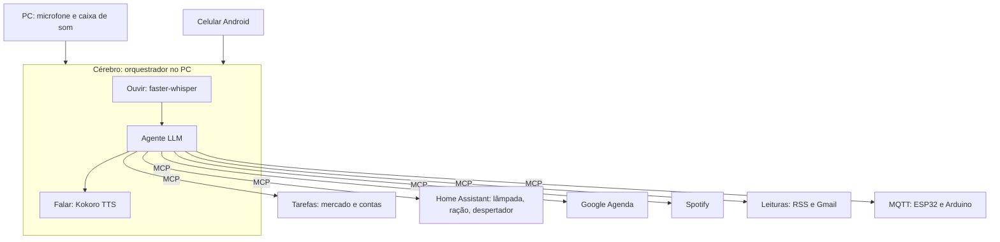

# Ignis


Assistente pessoal por voz que roda em casa. Ele ouve, decide e age nos meus aparelhos e serviços, com foco em **baixa latência**, **privacidade** e **segurança**.

> 🚧 **Em desenvolvimento.** Ainda não tem uma versão utilizável. O progresso está no [roadmap](#roadmap).

## Sumário

- [O que ele faz](#o-que-ele-faz)
- [Como funciona](#como-funciona)
- [Arquitetura](#arquitetura)
- [Princípios](#princípios)
- [Stack](#stack)
- [Hardware](#hardware)
- [Estrutura do repositório](#estrutura-do-repositório)
- [Roadmap](#roadmap)
- [Como rodar](#como-rodar)
- [Licença](#licença)

## O que ele faz

| Recurso | Descrição | Versão |
| --- | --- | --- |
| 🎙️ Conversa por voz | No PC e no celular Android. "Ignis Arise" acorda o Ignis com o PC bloqueado ou em repouso; em uso, basta chamá-lo de "Ignis" | v0 / v3 |
| 🔐 Só a sua voz | Responde apenas à voz cadastrada | v0 |
| 🖥️ Segundo plano | Inicia com o Windows, fica na bandeja e tem interface visual própria | futura |
| 🛒 Lista de mercado | Adiciona e remove itens por voz e diz o que está faltando com mais urgência | v0 |
| 💸 Contas a pagar | Lembra antes do vencimento e no dia | v0 |
| 💡 Casa conectada | Controla a lâmpada e avisa quando a ração dos gatos está baixa | v1 |
| ⏰ Despertador | Cria alarmes no celular por comando de voz | v3 |
| 📅 Agenda | Consulta e marca compromissos no Google Agenda | v3 |
| 🎵 Música | Toca minhas playlists no Spotify | v3 |
| ☀️ Resumo da manhã | Agenda do dia, contas, mercado urgente e destaques de leitura (Medium e newsletters), narrados em até 2 minutos | v3 |
| 🔧 Plataforma de comandos | Controla aparelhos que eu mesmo construo com ESP32 e Arduino via MQTT | v4 |

## Como funciona

Um comando passa por estas etapas:

1. **Ativação:** o cliente detecta "Ignis Arise", ou só "Ignis" com o PC em uso, no próprio aparelho, e só então envia o áudio ao cérebro. No PC, quem detecta é o sherpa-onnx.
2. **Ouvir:** o cérebro confere se a voz é a cadastrada, e o faster-whisper transcreve a fala.
3. **Decidir:** o agente LLM interpreta o pedido e escolhe uma ferramenta da lista permitida.
4. **Confirmar:** se a ação for sensível, o Ignis pede confirmação por voz antes de seguir.
5. **Agir:** a ferramenta é chamada no servidor MCP correspondente.
6. **Falar:** o Kokoro TTS narra a resposta.

Exemplos:

```text
"Ignis Arise."                          (PC bloqueado ou em repouso)
"Ignis, coloca leite e café na lista."
"Ignis, quais contas vencem esta semana?"
"Ignis, apaga a luz da sala."
"Ignis, me acorda às 6 e meia."
```

## Arquitetura



- O **PC** fica ligado 24 h e coordena tudo. O uso de um Raspberry Pi será reavaliado na v1.
- Na v0, o **LLM é o Claude Haiku 5.5, pela API**. O LLM local entra na v2.
- **Cada integração é um servidor MCP separado**, então trocar um serviço ou o modelo não mexe no resto.

## Princípios

- **Age só por ações validadas.** O agente tem uma lista fechada de ferramentas e nunca executa nada fora dela.
- **Conteúdo lido não dá ordens.** E-mails, posts e feeds são processados sem acesso às ferramentas de ação, como proteção contra prompt injection.
- **Confirma o que importa.** Ações sensíveis pedem confirmação por voz.
- **Privacidade por padrão.** A palavra de ativação e a transcrição são locais, e o áudio não sai de casa. Na v0, o texto de cada pedido vai para a API do Claude. Nada fica exposto direto na internet: o acesso externo é só por VPN.
- **Guiado por avaliação.** Uma suíte de comandos com as ações esperadas roda no CI a cada mudança.
- **Latência como meta.** Objetivo: menos de 1 s entre o fim da fala e o início da resposta.

## Stack

| Camada | Tecnologias |
| --- | --- |
| Voz | faster-whisper, sherpa-onnx, Kokoro TTS |
| Agente | Python, MCP, API do Claude (v0), LLM local (v2) |
| Dados | PostgreSQL |
| Casa | Home Assistant (integração Tuya), MQTT (Mosquitto), ESP32 |
| Infra | Docker, Tailscale, GitHub Actions |
| Integrações | Google Agenda, Spotify Web API, Gmail API (só leitura), RSS |

## Hardware

| Peça | Papel |
| --- | --- |
| PC com GPU NVIDIA (RTX 4060, 8 GB) | Central ligada 24 h: cérebro, servidores MCP, PostgreSQL, microfone e caixa de som |
| Raspberry Pi 5 | Em avaliação para a v1 |
| Celular Android | Segundo ponto de voz e destino dos alarmes |
| Lâmpada e alimentador Tuya | Aparelhos da casa controlados pelo Home Assistant |
| ESP32 / Arduino | Aparelhos próprios conectados via MQTT |

## Estrutura do repositório

```text
ignis/
├── cerebro/          # Orquestrador: STT, agente e TTS
├── mcp/              # Um servidor MCP por integração, cada um como pacote próprio
├── clientes/         # Pontos de voz (PC e Android): palavra de ativação e áudio
└── docs/             # Documentação, registro de decisões e ADRs
```

Cada pasta principal tem um README explicando o que mora nela.

Convenções:

- O código e a documentação são escritos em português do Brasil.
- Nomes de código e de arquivos não levam acento nem cedilha.
- O código segue a PEP 8.
- A pasta `mcp/` não tem `__init__.py`. Cada servidor usa o layout `src/` para não conflitar com o SDK `mcp`.

O cliente do PC é um processo separado do cérebro desde a v0. Assim, o cérebro pode mudar de máquina sem precisar ser reescrito.

As decisões tomadas até aqui estão em [`docs/decisoes.md`](docs/decisoes.md), e as de arquitetura, em [`docs/adr/`](docs/adr/).

## Roadmap

- [ ] **v0: Ignis no PC.** Voz, agente com a API do Claude, ferramentas, lista de mercado e contas
- [ ] **v1: Casa conectada.** Home Assistant, lâmpada, alimentador e reavaliação do Raspberry Pi
- [ ] **v2: Cérebro próprio.** LLM local na GPU, avaliação, segurança e latência abaixo de 1 s
- [ ] **v3: Assistente completo.** App Android, despertador, agenda, Spotify e resumo da manhã
- [ ] **v4: Plataforma de comandos.** MQTT e nós ESP32
- [ ] **Futuro:** interface visual própria e desbloqueio do Windows pela voz, com análise de riscos

## Como rodar

> Em breve. As instruções entram aqui junto com a v0.

## Licença

Copyright (C) 2026 Tensei-dev

Distribuído sob a [GNU General Public License, versão 3](LICENSE) ou, a seu critério, qualquer versão posterior. As bibliotecas e os modelos usados pelo projeto mantêm as próprias licenças.
